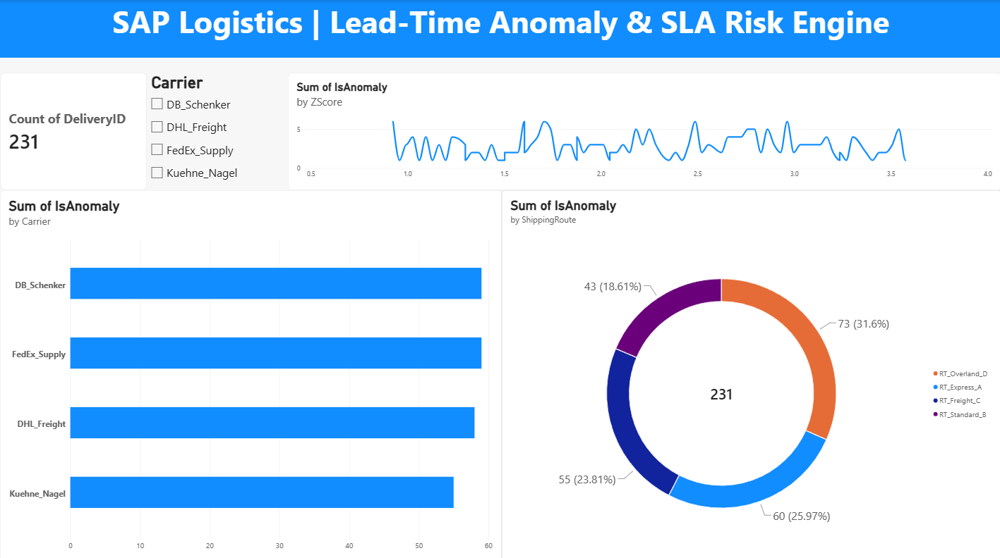
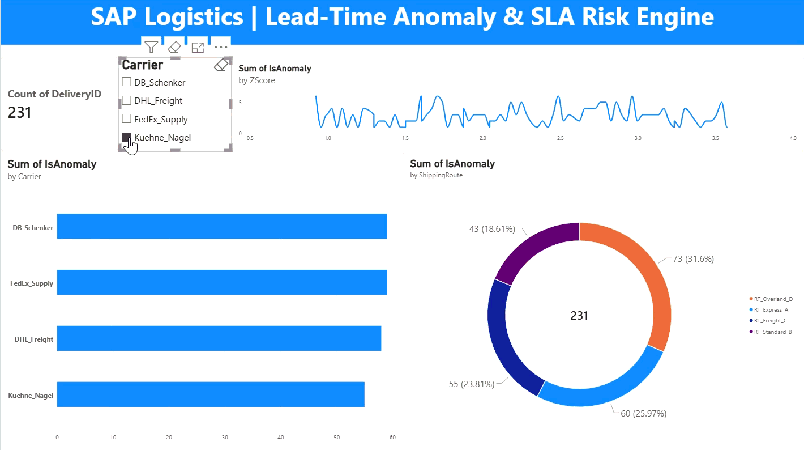

# SAP Logistics Lead-Time Anomaly Detector

## 📌 Project Overview
This project transitions enterprise supply chain analytics from traditional descriptive reporting into **diagnostic and predictive machine learning / statistical risk detection**. Building on simulated SAP S/4HANA logistics tables (`LIKP`), this pipeline automatically flags carrier delivery bottlenecks, route inefficiencies, and severe lead-time variances before they breach customer SLAs.

## 📊 Executive Dashboard Preview


### Interactive Dashboard Demo


## 🛠️ Tech Stack & Architecture
- **Language:** Python (`pandas`, `numpy`)
- **Database:** SQLite (`sap_logistics_analysis.db`)
- **BI & Analytics:** Power BI Desktop (`sap_logistics_lead_time_analytics.pbix`)
- **Methodology:** Statistical Z-Score and Interquartile Range (IQR) outlier detection on planned vs. actual delivery lead times.

---

## 📂 Repository Structure
```text
sap-logistics-anomaly-detector/
├── generate_shipping_data.py             # SAP shipping telemetry & carrier data generator
├── detect_lead_time_anomalies.py         # Statistical anomaly detection & scoring engine
├── sap_logistics_analysis.db             # Relational SQLite database (`LIKP_Shipping_Logistics`, `logistics_anomalies`)
├── anomaly_audit_report.csv              # Exported outlier audit summary
├── sap_logistics_executive_dashboard.png # Executive Power BI dashboard screenshot
├── logistics_anomaly_interactive.gif     # Interactive dashboard demonstration GIF
├── sap_logistics_lead_time_analytics.pbix# Power BI executive dashboard report model
└── README.md                             # Project documentation

## 🚀 How to Run the Pipeline
1. Generate the Enterprise Logistics Dataset:

```powershell
python generate_shipping_data.py
```

(Simulates 1,500 delivery records across plants, routes, and carriers with embedded delay anomalies.)

2. Execute the Anomaly Detection Engine:

```powershell
python detect_lead_time_anomalies.py
```

(Computes lead-time variances and Z-scores, updates the SQLite database, and exports anomaly_audit_report.csv.)

3. Visualize in Power BI:

* Open sap_logistics_lead_time_analytics.pbix in Power BI Desktop.

* Interact with SLA breach cards, carrier performance bar charts, route distribution donut charts, and lead-time variance line charts.